# Diagrama del Modelo Dimensional (Esquema de Constelacion de Hechos)

El siguiente diagrama representa la arquitectura dimensional del Data Warehouse de la Escuela Politécnica Nacional en notación Mermaid. Presenta las dimensiones conformadas y las tablas de hechos que modelan la oferta académica, la estructura de gobernanza y la divulgación institucional.

```mermaid
erDiagram
    dim_facultad {
        BIGINT facultad_key PK
        VARCHAR nombre
        VARCHAR sigla
        VARCHAR decano
        VARCHAR subdecano
        VARCHAR url
        VARCHAR contacto_correo
        VARCHAR contacto_telefono
        VARCHAR ubicacion_campus
    }

    dim_nivel_formacion {
        BIGINT nivel_key PK
        VARCHAR codigo_nivel
        VARCHAR nombre_nivel
        VARCHAR ciclo_academico
    }

    dim_modalidad {
        BIGINT modalidad_key PK
        VARCHAR nombre_modalidad
        VARCHAR descripcion
    }

    dim_carrera {
        BIGINT carrera_key PK
        VARCHAR nombre_carrera
        VARCHAR titulo_otorga
        VARCHAR codigo_resolucion
        TEXT perfil_ingreso
        TEXT perfil_egreso
        VARCHAR url_carrera
    }

    dim_cargo {
        BIGINT cargo_key PK
        VARCHAR nombre_cargo
        VARCHAR tipo_gobierno
    }

    dim_autoridad {
        BIGINT autoridad_key PK
        VARCHAR nombre_completo
        VARCHAR titulo_academico
        VARCHAR correo_contacto
        INTEGER es_vigente
        VARCHAR fecha_inicio_vigencia
        VARCHAR fecha_fin_vigencia
    }

    dim_categoria_noticia {
        BIGINT categoria_key PK
        VARCHAR nombre_categoria
    }

    dim_tiempo {
        INTEGER tiempo_key PK
        VARCHAR fecha
        INTEGER anio
        INTEGER mes
        VARCHAR mes_nombre
        INTEGER trimestre
        INTEGER semestre
    }

    fact_oferta_academica {
        BIGINT oferta_key PK
        BIGINT carrera_key FK
        BIGINT facultad_key FK
        BIGINT nivel_key FK
        BIGINT modalidad_key FK
        INTEGER tiempo_extraccion_key FK
        INTEGER duracion_periodos
        REAL duracion_anios
        INTEGER creditos_totales
        INTEGER es_acreditada
    }

    fact_designacion_autoridades {
        BIGINT designacion_key PK
        BIGINT autoridad_key FK
        BIGINT cargo_key FK
        BIGINT facultad_key FK
        INTEGER es_titular
        INTEGER tiempo_designacion_key FK
    }

    fact_comunicacion_institucional {
        BIGINT noticia_key PK
        BIGINT categoria_key FK
        INTEGER tiempo_publicacion_key FK
        VARCHAR titulo
        INTEGER longitud_caracteres
        INTEGER conteo_palabras
        VARCHAR url
    }

    dim_facultad ||--o{ fact_oferta_academica : "oferta"
    dim_carrera ||--o{ fact_oferta_academica : "clasifica"
    dim_nivel_formacion ||--o{ fact_oferta_academica : "regula"
    dim_modalidad ||--o{ fact_oferta_academica : "imparte"
    dim_tiempo ||--o{ fact_oferta_academica : "extraida_en"

    dim_autoridad ||--o{ fact_designacion_autoridades : "desempenia"
    dim_cargo ||--o{ fact_designacion_autoridades : "asigna"
    dim_facultad ||--o{ fact_designacion_autoridades : "adscrita_a"
    dim_tiempo ||--o{ fact_designacion_autoridades : "vigente_desde"

    dim_categoria_noticia ||--o{ fact_comunicacion_institucional : "categoriza"
    dim_tiempo ||--o{ fact_comunicacion_institucional : "publicada_en"
```

